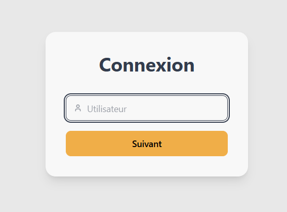
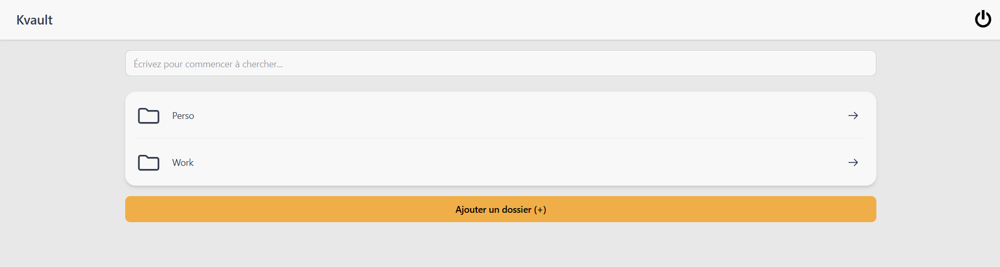
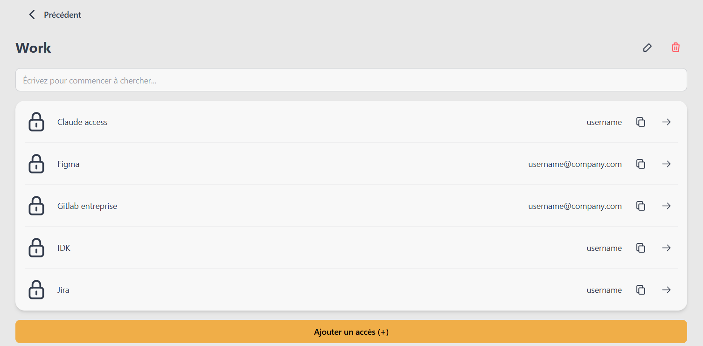
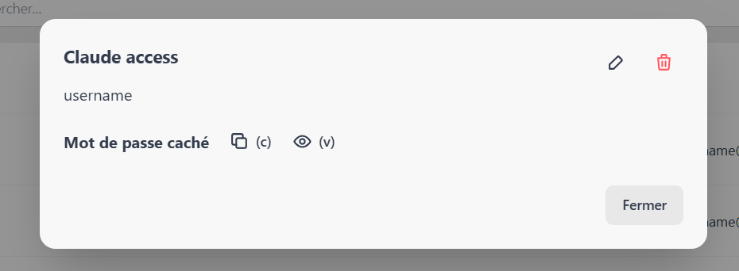

<p align="center">
  
</p>

<h1 align="center">Kvault</h1>

Kvault is a web-based password manager, built in Svelte / Rust / Wasm with CRYSTALS-Kyber encryption. This repository contains the **front-end** edition.<br/>The API required to run the application is provided by a separate Rust back-end repo

> **Project status:** The user interface and the WebAssembly encryption module
> are included in this repository. The back-end is not included: you need a
> compatible instance and must configure its URL to sign in or create an
> account.

**Rust back-end repository:** [here](https://github.com/skewnart/kvault-back)

## Screenshots






## Features

- Sign up from a link containing an identifier (`/register/[guid]`).
- Sign in with a username, a login password, and an encryption password (never stored on the server).
- Create, rename, search, and delete folders.
- Create and manage entries within a folder, including their name,
  description, and password.
- Reveal and copy an entry's password.
- Encrypt and decrypt data in the browser using the Rust WebAssembly module
  included in `src/lib/wasm_pkg/`.

## Tech stack

- [Svelte](https://svelte.dev/) and [SvelteKit](https://svelte.dev/docs/kit)
- [TypeScript](https://www.typescriptlang.org/) and [Vite](https://vite.dev/)
- [Tailwind CSS 4](https://tailwindcss.com/) and [DaisyUI 5](https://daisyui.com/)
- WebAssembly compiled from Rust for encryption operations

## Prerequisites

- Node.js **22** (the version used by the GitHub Actions workflows)
- npm
- A Kvault back-end instance compatible with the routes used by the front-end

The generated WebAssembly files are already included in this repository. You do
not need to install Rust or compile the WASM module just to run the front-end.

## Installation and development

From the repository root, install dependencies:

```bash
npm ci
```

Create a `.env` file and set the API base URL:

```dotenv
PUBLIC_API_URL=https://api.example.test
```

Replace `https://api.example.test` with the URL of your back-end. This URL is
bundled into the front-end at build time; the `PUBLIC_` prefix means it is
available to client-side code, so it must not contain any secrets. Set this
variable before starting, checking, or building the application.

Start the development server:

```bash
npm run start
```

By default, Vite serves the application at `http://localhost:5173`. Signing in,
signing up, and managing folders require the back-end to be running and
reachable from the browser.

## npm scripts

| Command | Description |
| --- | --- |
| `npm run start` | Start the Vite development server. |
| `npm run build` | Create a production build. |
| `npm run update_wasm` | Copy the WASM package from `../kvault-wasm/wasm_pkg`. |

`update_wasm` expects the WASM build repository to be located next to this
repository and the `cp` command to be available in the shell environment.

## Application routes

| URL | Purpose |
| --- | --- |
| `/login` | Sign in to an existing account. |
| `/register/[guid]` | Sign up using an identifier provided by the back-end. |
| `/` | Browse and search folders after signing in. |
| `/folder/[folderId]` | View and manage a folder's entries. |
| `/logout` | Clear the front-end session cookie and return to the login page. |

## Back-end configuration and integration

The HTTP client is centralized in `src/lib/api.ts`. It uses `PUBLIC_API_URL` as
its base URL and calls routes for sign-in, sign-up, cryptographic envelopes,
folders, and entries. The token returned during sign-in is used for protected
requests.

The front-end expects the back-end to provide the corresponding routes, response
formats, HTTP status codes, and CORS rules. Since the Rust repository is
separate and is not included here, refer to its documentation for installation,
startup, configuration, and the full API contract.

## License

This project is licensed under the GNU General Public License v3.0 or later.
See the [LICENSE](./LICENSE) file for the full text.
